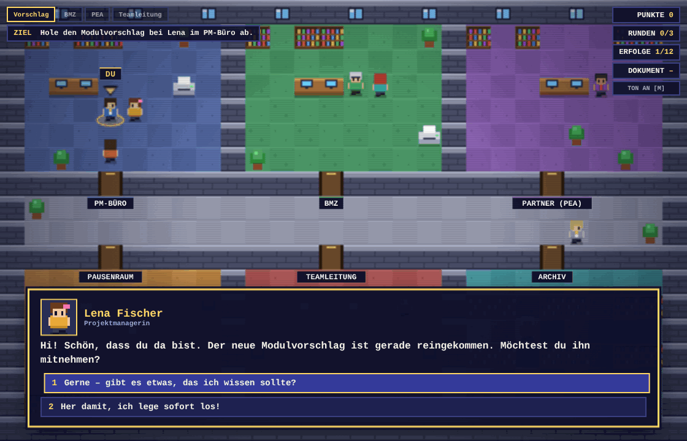
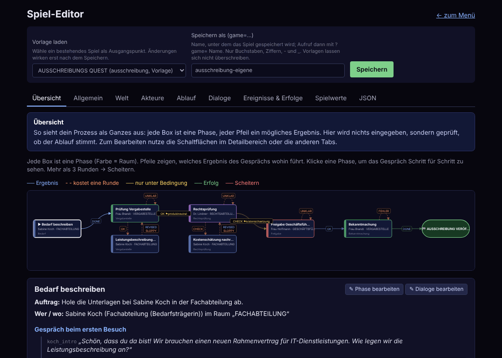
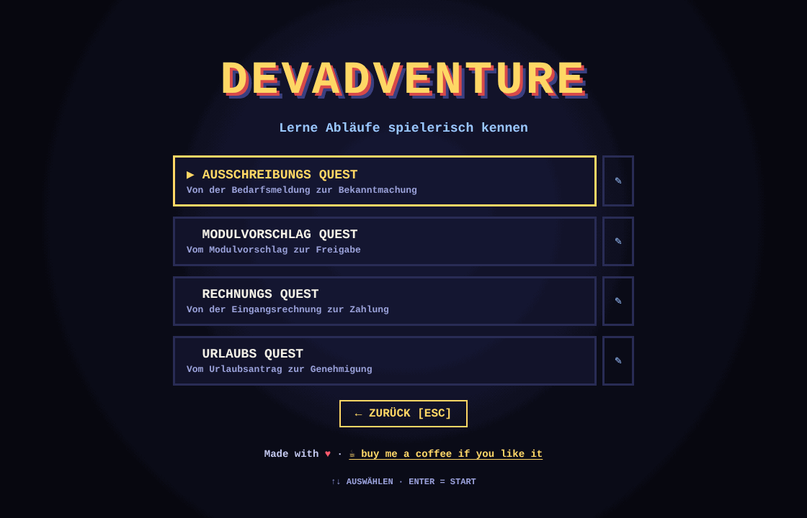
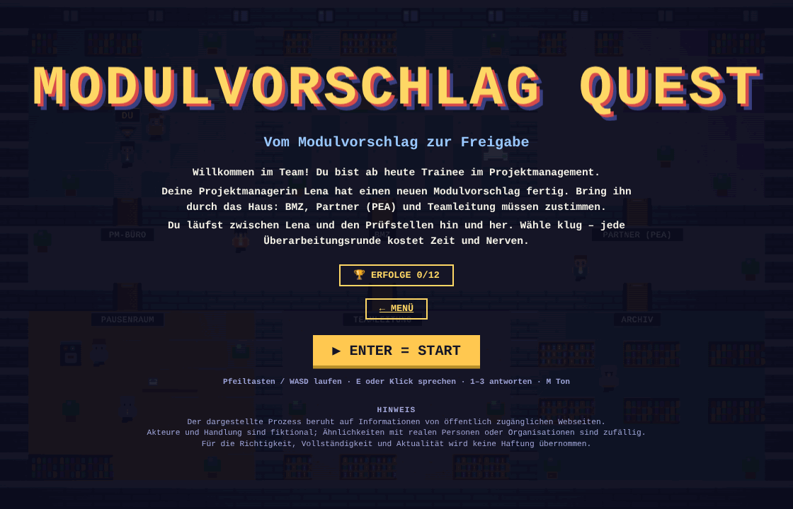

# devadventure

**Learn business processes by walking through them.**
devadventure is a fun 90s-style top-down browser game in which you carry a document through an
office building – from desk to desk, from approval to approval – and learn why each step of a
process exists. You play a trainee who runs between colleagues, answers their questions, and
finds out what happens when a step is skipped.

The processes are not hard-coded: **every game is a single JSON file** (rooms, people, process
steps, dialogs, scoring, texts). You can build your own with the built-in editor, no programming
required.

<p align="center">
  
  
</p>

> The game content and the default interface texts are in German. All texts are configurable
> (see [Game files](#game-files)), so other languages are a matter of editing JSON.

---

## Contents

- [What it is](#what-it-is)
- [Included games](#included-games)
- [Quick start](#quick-start)
- [How to play](#how-to-play)
- [How it works](#how-it-works)
- [Build your own game](#build-your-own-game)
- [Game files](#game-files)
- [The editor](#the-editor)
- [Configuration](#configuration)
- [Deployment and operation](#deployment-and-operation)
- [SEO and link previews](#seo-and-link-previews)
- [Development](#development)
- [Troubleshooting](#troubleshooting)
- [License and support](#license-and-support)

---

## What it is

A process like "approve an invoice" or "publish a public tender" is easy to describe and hard
to *feel*. devadventure turns it into a small adventure:

- The **building** has six rooms, one per role or department (for example procurement office,
  legal, management). **Colleagues** stand in their rooms; others wander through the corridors
  and greet you.
- A **document** (a proposal, a request, an invoice, …) travels with you. You hand it to the
  right person in the right order.
- Every conversation is a **choice**: answer well and the process moves on; answer badly and you
  get sent back for rework, which costs a **revision round**. Too many rounds and the process
  fails.
- After each answer a **"Warum so?" card** explains *why* the process works this way. The end
  screen lists all your decisions with these explanations.
- **Random incidents** (printer jam, a supplier offering a gift, a manager rushing you) test
  how you behave under pressure, and **achievements** reward good habits.
- Wrong turns are not dead ends: a **hint colleague** sells you tips for points, a **fact
  colleague** tells you background knowledge for bonus points.

It is a standalone [Next.js](https://nextjs.org) app: canvas + React, no database, no external
services. Pixel art and sound are generated in code, so there are no asset files.

## Included games

| Game (`?game=…`) | Process | What you learn |
|---|---|---|
| `modulvorschlag` | Review of an internal proposal: PM office → BMZ → partner (PEA) → team lead | Complete documents, marking changes, partner feedback |
| `urlaubsantrag` | Vacation request: team lead → HR → payroll | Substitute arrangements, remaining days, approval order |
| `ausschreibung` | Public tender: need → procurement office → legal → management → publication | Product-neutral specifications, cost estimates, award criteria, equal treatment, minimum deadlines |
| `rechnungsfreigabe` | Incoming invoice: capture → goods check → three-way match → approval → payment | Order reference, goods receipt, segregation of duties, discount periods, fraud awareness |

<p align="center">
  
  
</p>

They also serve as templates for your own games. `ausschreibung` and `rechnungsfreigabe` use
**conditional branching**: an earlier answer sets a flag that a later stage checks, so skipping
a step comes back to bite you.

## Quick start

Requirements: **Node.js 20.9 or newer** (required by Next.js 16) and npm.

```bash
git clone https://github.com/jzakotnik/devadventure.git
cd devadventure
npm install
npm run dev        # http://localhost:3000
```

Open <http://localhost:3000>, choose *Bestehendes Spiel spielen* and pick a game. In dev mode
the editor can always save; for production see [Deployment and operation](#deployment-and-operation).

Useful commands:

| Command | Purpose |
|---|---|
| `npm run dev` | Development server with hot reload |
| `npm run build` | Production build (run this before `npm start`) |
| `npm start` | Production server (`next start`, port 3000, `-p` to change) |
| `npm run typecheck` | TypeScript check |
| `npm run format` | Prettier for `.ts`/`.tsx` |

## How to play

| Action | Keys / mouse |
|---|---|
| Walk | Arrow keys or `W` `A` `S` `D`; or click a floor tile (the character finds the way) |
| Talk to a colleague | Walk next to them and press `E` / `Enter`, or click them |
| Read faster / continue | `E`, `Enter` or `Space` |
| Choose an answer | `1`–`4`, or `↑` `↓` and `Enter`, or click |
| Sound on/off | `M` |
| Close the achievements screen | `Esc` |
| Menu | `↑` `↓` select, `Enter` start, `Esc` back |

The **HUD** shows the process steps (top left), your current task (**ZIEL / AUFTRAG**), points,
revision rounds (`used/limit`), unlocked achievements and the document with its version.

**Scoring** (defaults, all configurable per game):

- Every answer carries points; wrong answers cost points.
- A **hint** costs 2 points. A **fact** gives 3 bonus points, once per stage.
- A revision round is used whenever a result sends you back. More than the **round limit** ends
  the game without success.
- Stars at the end: 3 stars for no round, 2 for one round, 1 otherwise.
- Your best score and achievements per game are stored in the browser (`localStorage`), nothing
  is sent to a server.

## How it works

### Architecture

```
 app/_content/*.json ──┐                        ┌── browser ───────────────────────────┐
 data/games/*.json  ───┼─► load.ts / store.ts ──►  GameClient (React)                  │
 (saved by the editor) │   read + validate      │   ├─ engine.ts   process state machine│
                       │   (server, per request)│   ├─ world.ts    movement, wanderers  │
                       └────────────────────────►   ├─ render.ts   canvas, pixel sprites│
                                                │   └─ audio.ts    WebAudio sound       │
                                                └──────────────────────────────────────┘
```

1. A request for `/?game=<id>` makes the **server** read the game's JSON from `app/_content/`
   (built-in) or `data/games/` (saved by the editor), validate it, and pass it to the page. An
   unknown game gives a 404, an invalid one an error page listing the problems.
2. The **client** runs the whole game. There is no game server, no WebSocket, no API calls
   while playing.
3. The **engine** is a pure, immutable state machine (no DOM, no React) that turns player
   decisions into the next state. The **world** handles real-time movement and wandering
   colleagues, the **renderer** draws the building and characters on a canvas.

### The process model

A game is a graph of **stages**:

```
stage ──talk to its NPC──► dialog ──choice──► result ──"on" table──► effect ──► next stage
```

- A **stage** says *who* in *which room* the player must talk to, and which dialog opens.
- A **dialog** is a set of nodes with the colleague's text and up to four answers. An answer
  either continues in another node (`goto`) or ends with a **result** key such as `OK` or
  `UNKLAR`.
- The stage's **`on`** table maps each result to an **effect**: go to the next stage, use up a
  revision round, add points, give the document, show a message, or end the game.
- An effect can be a **list with conditions** (`when`): the first one that applies wins. This is
  how "this only passes if you did X earlier" is expressed.

Talking to the *wrong* colleague is not an error: they politely send you on, and it is counted
(`wrongVisits`). Colleagues with a `role` act as helpers: `hint` sells a tip for the current
stage, `fact` tells a background fact.

## Build your own game

**With the editor (recommended)**

1. Open `/editor` and load the template that is closest to your process.
2. Walk through the tabs, replace names, texts, rooms and steps. Every field explains itself.
3. Check the **Übersicht** tab: does the graph show the flow you intended?
4. Fix any problems the editor lists, then **save under a new id**.
5. Play it at `/?game=<id>`.

**By hand**

1. Copy a file in `app/_content/`, for example `rechnungsfreigabe.json`, to `my-process.json`.
2. Change at least `id`, `title`, `npcs`, `stages`, `dialogs`, `pipeline` and `texts`; the map
   and the six rooms can stay (only the room labels need to match your story).
3. Open `/?game=my-process`. The validator names anything that does not fit.

**A note on authoring**

- The player should be someone who *runs between* colleagues (a trainee, an assistant), because
  that is what makes the walking meaningful. Avoid answers that assume authority the player
  does not have.
- Give every wrong answer a `learn` card that explains the rule behind the process; this is
  where the learning happens.
- Keep rework cheap in points but expensive in rounds, so detours never score better than a
  clean run.

## Game files

A game is one JSON file. The TypeScript types are in [`app/_game/schema.ts`](app/_game/schema.ts)
and the consistency checks in [`app/_game/validate.ts`](app/_game/validate.ts).

### Top-level keys

| Key | Meaning |
|---|---|
| `id`, `title`, `subtitle`, `intro[]` | Name and title screen text; `intro` is a list of paragraphs |
| `disclaimer[]` | Optional small print at the bottom of the title screen, one entry per line (the built-in games use it for sources, fiction and liability) |
| `roundLimit` | Revision rounds allowed; one more ends the game |
| `firstStage` | Stage id where the game starts |
| `pipeline[]` | Progress bar: `{label, stages[]}` per big step |
| `texts` | Fixed sentences: wrong colleague (`{room}` is replaced), hint/fact prefixes, success and failure screens |
| `map` | `layout[]` (one string per row) and `start: [x, y]` |
| `rooms[]` | `{id, label, color, rect: [x, y, w, h]}` |
| `npcs{}` | Colleagues by id: `name`, `title`, `room`, `at`, `facing`, `look`, optional `role` |
| `stages[]` | The process steps (see below) |
| `dialogs{}` | Conversation nodes by id |
| `events[]`, `eventSettings` | Random incidents and how often they occur |
| `achievements[]` | Badges with declarative rules |
| `ambient` | Wandering colleagues and their greetings |
| `scoring`, `ui`, `debrief` | Optional: points and stars, interface texts, extra statistics (all have defaults) |

### Map legend

`#` wall · `_` room floor · `.` corridor · `+` door · `d` desk · `s` shelf · `p` plant ·
`c` coffee machine · `r` printer · `t` table. All rows must have the same length; a room's
`rect` and its NPCs' positions must lie inside it and on walkable tiles.

### A stage with conditional results

```json
{
  "id": "hr_check",
  "title": "Prüfung Personal",
  "room": "pea",
  "npc": "petrov",
  "objective": "Bringe den Antrag zu Herrn Petrov.",
  "hint": "Herr Petrov prüft Resturlaub und Vertretung.",
  "fact": "Die Personalabteilung führt das Urlaubskonto.",
  "dialog": "hr_intro",
  "repeatDialog": "hr_recheck",
  "on": {
    "CHECK": [
      { "when": { "flag": "vertretung" }, "next": "payroll", "score": 10,
        "message": "Personal ist einverstanden!", "tone": "good" },
      { "next": "rework_hr", "costsRound": true,
        "message": "Es fehlt die Vertretung. Zurück zu Anna.", "tone": "bad" }
    ],
    "UNKLAR": { "costsRound": true, "message": "Herr Petrov braucht Zahlen.", "tone": "bad" }
  }
}
```

### A dialog (shortened)

```json
"hr_intro": {
  "text": "Personalabteilung, guten Tag. Bitte Ihren Antrag.",
  "choices": [
    {
      "text": "Antrag samt Resturlaubsübersicht.",
      "reply": "Herr Petrov prüft die Unterlagen.",
      "learn": "Mit Resturlaubsübersicht ist die Prüfung in Minuten erledigt.",
      "score": 8,
      "result": "CHECK"
    }
  ]
}
```

Answer fields: `text`, `reply` (colleague's reaction), `learn` (the "Warum so?" card),
`score`, `result` **or** `goto`, `round` (± revision rounds, mostly for events), `flag` (remember
something for later conditions and achievements). A node without answers uses `next` or
`result` and just shows a "Weiter" button.

### Effects

`next` (omit to stay), `costsRound`, `docVersion` (+n), `giveDoc`, `score`, `ending`
(`success` or `failed`), `message`, `tone` (`good`, `bad`, `info`) and `when`.

### Conditions

`when` (and achievement `rule`) take any of these; **all given fields must hold**:
`flag`, `stat` + `gte`, `statAtMost`, `finished`, `roundsAtMost`, `roundsAtLeast`,
`scoreAtLeast`, `scoreAtMost`, `roomsVisited`.
Statistics: `talks`, `steps`, `hints`, `facts`, `events`, `eventsGood`, `eventsBad`,
`wrongVisits`, `rooms`.

### Optional blocks

```json
"scoring": { "hintCost": 3, "factBonus": 2,
             "stars": [ { "roundsAtMost": 0, "stars": 3 }, { "roundsAtMost": 2, "stars": 2 } ] },
"ui": { "document": "VERGABEAKTE", "objective": "AUFTRAG" },
"debrief": { "stats": [ { "label": "TIPPS", "stat": "hints" } ] }
```

- `scoring`: hint cost, fact bonus and the star thresholds (first matching row wins, else 1 star).
- `ui`: every button and HUD label (see `DEFAULT_UI` in `schema.ts`). Set `ui.document` to `""`
  to hide the document display, or give it a name (`ANTRAG`, `RECHNUNG`, …).
- `debrief.stats`: extra lines on the end screen.

### Random events and achievements

- **Events** appear after `eventSettings.minSteps`–`maxSteps` walked steps, at most `maxPerRun`
  per game, never twice, never in the first stage. Optional `stages` and `requiresDoc` limit when
  one can occur, `weight` makes it more or less likely. Answers use the same fields as dialogs.
- **Achievements** have an `id`, `title`, `description`, `icon` (an emoji) and a `rule`
  (see [Conditions](#conditions)). A rule that needs a `flag` must have an answer or event that
  sets it – the validator checks this.

### Wandering colleagues

`ambient.wanderers[]` walk randomly through the building; when one passes within
`greetDistance` tiles they say a random line from `ambient.lines` (per-person `cooldownSec`).
They never block the player and have no dialog.

## The editor

`/editor` is a form-based editor for game files, with an explanation next to every field.

| Tab | What you do there |
|---|---|
| **Übersicht** | See the process as a graph: stages as boxes (colour = room), results as arrows (dashed = costs a round, yellow = conditional), rework loops below the stage they branch from. Click a stage to read its conversation as a script: answer → result → what happens next |
| **Allgemein** | Title, intro, round limit, start stage, fixed texts, progress bar |
| **Welt** | Building plan, rooms, wandering colleagues |
| **Akteure** | The people: name, role, room, position, looks |
| **Ablauf** | Stages and what each result leads to |
| **Dialoge** | The conversations |
| **Ereignisse & Erfolge** | Random incidents and badges |
| **Spielwerte** | Points, stars, interface texts, end-screen statistics |
| **JSON** | The whole game as text: edit it, **download** it, **upload** a file (checked on the spot), or copy a ready-made **AI prompt** (see below) |

Reference fields (room, colleague, stage, dialog) are dropdowns, problems are listed live, and
saving is only possible when the game is valid.

**Download, upload and AI generation**

The JSON tab can export and import a whole game, which also makes it easy to let an AI
assistant write one:

1. Optionally type the process you want (for example "Reisekostenabrechnung") into the field next
   to **✨ KI-Prompt kopieren** and click the button. The clipboard now holds the format rules, the
   constraints the validator enforces, and the currently loaded game as a working example.
2. Paste it into an AI assistant. It should answer with a single JSON document.
3. Save the answer as a `.json` file and **⬆ Hochladen** it (or paste it into the text box and click
   **JSON übernehmen**).
4. The editor checks it immediately: a syntax error is shown with line and column; a game with
   rule violations (unknown room, unhandled result, unreachable flag, …) is loaded so you can fix
   it, and lists every problem. Only a valid game can be saved.
5. Review the **Übersicht** tab, correct what the AI got wrong, and save under a new id.

**⬇ Herunterladen** exports the current state as `<id>.json`, for backups or to commit a game to
`app/_content/`. Files up to 1 MB are accepted. AI-written games deserve a read-through: the
validator proves the game is consistent, not that its content is factually correct.

**Saving**

- Games are saved as `data/games/<id>.json`. The id may contain letters, digits, `-` and `_`
  (max. 40 characters). The saved game gets this id internally.
- The built-in games are read-only ("Vorlage"); save your changes under a new id.
- The folder `data/games/` is checked in with a `.gitkeep` so it exists after a fresh checkout;
  the saved files are git-ignored. To ship a game with the app, move its file to
  `app/_content/` and commit it.
- Saved games can be played and shared, but they are `noindex` and not listed in the sitemap.
- In production, saving is **off** unless you set `GAME_EDITOR=1`. The editor has **no login**:
  see [Securing the editor](#securing-the-editor).

## Configuration

### Environment variables

Put them in `.env.production` in the project root (read by `next build` and `next start`;
`.env*` is git-ignored).

| Variable | When | Purpose |
|---|---|---|
| `NEXT_PUBLIC_SITE_URL` | **build time** | Public base URL, e.g. `https://quest.example.com`. Used for canonical links, Open Graph tags, sitemap and `robots.txt`. Rebuild after changing it. Without it the URLs point to `localhost` |
| `GAME_EDITOR` | run time | `1` allows saving games in production. Off by default; always on in dev mode |
| `PORT` | run time | Port of `next start` (default 3000) |

### In code

- [`app/_game/site.ts`](app/_game/site.ts): site name, tagline and description for metadata, and the
  support link shown on the start screen.
- [`app/menu.module.css`](app/menu.module.css), [`app/game.module.css`](app/game.module.css),
  [`app/editor.module.css`](app/editor.module.css): styles of the menu, the game and the editor.
- Colours of rooms and characters live in the game files; sprites and sounds are generated in
  `app/_game/render.ts` and `app/_game/audio.ts`.

## Deployment and operation

devadventure needs a **Node.js server** (it reads game files from disk on each request and has
an API for the editor). It does not need a database, WebSockets or any external service.

### 1. Build and start

```bash
git pull
npm ci
npm run build                  # needs .env.production first (NEXT_PUBLIC_SITE_URL)
npx next start -p 5900 -H 127.0.0.1
```

- Bind to `127.0.0.1` when a reverse proxy sits in front, so the app is reachable only through it.
- Never run `npm run dev` in production: it opens a hot-reload WebSocket, always allows saving
  and ignores `.env.production`.
- The server must be started **from the project root** (the app finds `app/_content/` and
  `data/games/` relative to the working directory).

### 2. Keep it running with pm2

```js
// ecosystem.config.cjs
module.exports = {
  apps: [{
    name: "devadventure",
    cwd: "/path/to/devadventure",          // the project root, an absolute path
    script: "node_modules/next/dist/bin/next",
    args: "start -p 5900 -H 127.0.0.1",
    env: { NODE_ENV: "production" },
  }],
}
```

```bash
pm2 start ecosystem.config.cjs
pm2 save                    # restore after a reboot (together with `pm2 startup`)
pm2 logs devadventure
```

To change the configuration, `pm2 delete devadventure` and start again; `restart` keeps the old
working directory.

### 3. nginx and HTTPS

```nginx
server {
    listen 80;
    listen [::]:80;
    server_name quest.example.com;

    location / {
        proxy_pass http://127.0.0.1:5900;
        proxy_set_header Host $host;
        proxy_set_header X-Real-IP $remote_addr;
        proxy_set_header X-Forwarded-For $proxy_add_x_forwarded_for;
        proxy_set_header X-Forwarded-Proto $scheme;
    }
}
```

```bash
sudo ln -s /etc/nginx/sites-available/quest /etc/nginx/sites-enabled/
sudo nginx -t && sudo systemctl reload nginx
sudo certbot --nginx -d quest.example.com      # adds the HTTPS block and the redirect
sudo certbot renew --dry-run                   # check automatic renewal
```

Before running certbot, `dig +short quest.example.com A` must return your server's IP, and
there must be **no AAAA record** pointing elsewhere (Let's Encrypt prefers IPv6). No WebSocket
headers are needed.

### 4. Updating

```bash
cd /path/to/devadventure
git pull
npm ci && npm run build
pm2 restart devadventure
```

### Saved games and backups

- Saved games live only in `data/games/`. Keep that folder between deployments (`git pull` in
  place is fine; a fresh clone or `rsync --delete` would remove them) and include it in backups.
- The folder must be writable by the user that runs the app. If you mount a volume there, it
  hides the checked-in placeholder and must be writable as well.
- Serverless platforms with a read-only or temporary filesystem are not suitable for the
  editor; the built-in games work anywhere Node runs.

### Securing the editor

With `GAME_EDITOR=1`, anyone who can reach `/editor` can save games to your server (up to
1 MB each). Either leave `GAME_EDITOR` unset in public deployments, or protect the editor in
nginx:

```nginx
location ~ ^/(editor|api/) {
    auth_basic "devadventure editor";
    auth_basic_user_file /etc/nginx/.htpasswd;     # sudo htpasswd -c /etc/nginx/.htpasswd you
    proxy_pass http://127.0.0.1:5900;
    proxy_set_header Host $host;
    proxy_set_header X-Forwarded-Proto $scheme;
}
```

Players never use `/api/` or `/editor`; the game list is read on the server.

### Endpoints

| Path | Purpose |
|---|---|
| `/` | Start menu |
| `/?game=<id>` | Play a game |
| `/editor`, `/editor?game=<id>` | Editor (open a game as template) |
| `GET /api/games` | List games `{games: [{id, title, subtitle, source}], canSave}` |
| `GET /api/games/<id>` | Read a game |
| `PUT /api/games/<id>` | Validate and save a game (needs `GAME_EDITOR=1` in production; built-in ids are refused) |
| `/og?game=<id>` | Generated link-preview image |
| `/sitemap.xml`, `/robots.txt`, `/manifest.webmanifest` | SEO and web app files |

## SEO and link previews

- Every game has its own title, description (subtitle + first intro paragraph), canonical URL,
  Open Graph and Twitter card, and schema.org `VideoGame` data. The preview image is generated
  per game at `/og?game=<id>`.
- Built-in games are indexed and listed in `/sitemap.xml`. Games saved in the editor are
  shareable but `noindex`. `/editor` and `/api/` are disallowed in `robots.txt`.
- Unknown games return a real 404.
- Icons: `app/favicon.ico`, `app/icon.svg`, `app/apple-icon.png`, `public/icon-192.png`,
  `public/icon-512.png`; the web app manifest is generated in `app/manifest.ts`.
- Set `NEXT_PUBLIC_SITE_URL` at build time or all absolute URLs point to `localhost`.

## Development

```
app/
├─ _game/            engine and tooling (no UI)
│  ├─ schema.ts      types of a game file + defaults
│  ├─ validate.ts    consistency checks (references, results, flags, map)
│  ├─ engine.ts      pure state machine: stages, dialogs, rounds, score, events, achievements
│  ├─ world.ts       real-time movement, click-to-walk (BFS), wandering colleagues
│  ├─ map.ts         tile map, rooms, path finding
│  ├─ render.ts      canvas renderer and procedural sprites; font.ts: 3x5 pixel font
│  ├─ audio.ts       WebAudio chiptune sound and music
│  ├─ load.ts        load + validate a game on the server
│  ├─ store.ts       list/read/save games on disk (server only)
│  └─ site.ts        site-wide metadata constants
├─ _components/      React: GameClient (HUD, loop), DialogBox, Debrief, Achievements, Menu
│  └─ editor/        the editor: Editor (shell), Tree (generic form), Overview (graph), help.ts (texts)
├─ _content/         the built-in games (JSON)
├─ api/games/        editor API
├─ editor/, og/      editor page, preview image route
├─ page.tsx          menu and game page (metadata, JSON-LD)
└─ robots.ts, sitemap.ts, manifest.ts, not-found.tsx, layout.tsx
data/games/          games saved by the editor (git-ignored, .gitkeep tracked)
docs/screenshots/    images used in this README
```

- **Stack:** Next.js 16 (App Router), React 19, TypeScript. No further runtime dependencies.
- **The game code is UI-agnostic:** `app/_game/` uses relative imports only, and the engine has
  no DOM or React dependency, which keeps it testable and portable.
- **Next.js 16 differs from older versions.** `AGENTS.md` points to the bundled documentation in
  `node_modules/next/dist/docs/`; read it before changing framework-level code.
- **Formatting:** Prettier (`npm run format`), no semicolons, double quotes. Run
  `npm run typecheck` before committing.
- **Adding a game:** drop a validated JSON file into `app/_content/`; it appears in the menu, the
  sitemap and the editor's template list automatically.
- **Extending the model:** add the field to `schema.ts`, enforce it in `validate.ts`, implement
  it in `engine.ts`, and add its explanation to `app/_components/editor/help.ts` so the editor
  describes it.

## Troubleshooting

| Symptom | Likely cause and fix |
|---|---|
| `502 Bad Gateway` from nginx | The app is not running on the proxied port. Check `pm2 status`, `pm2 logs`, and `curl -I http://127.0.0.1:5900`. Common causes: no build (`npm run build`), wrong `cwd` in the pm2 config, wrong port |
| pm2 shows `online` but `pid N/A` and empty logs | The process dies at once, usually because `cwd` does not exist or is not the project root |
| `Could not find a production build` | Run `npm run build` in the project root |
| `Bad port: "6000" is reserved` | Next.js refuses browser-restricted ports such as 6000; use another port |
| Console error about `wss://…/_next/hmr` | The server runs in dev mode. Use `npm run build` and `next start` |
| Canonical or preview URLs say `localhost` | The build ran without `NEXT_PUBLIC_SITE_URL`. Set it in `.env.production` and rebuild |
| Editor cannot save | Production needs `GAME_EDITOR=1`; `data/games/` must exist and be writable; the id must not belong to a built-in game; fix any listed validation problem |
| Saved games vanish after a deploy | `data/games/` was replaced or not persistent; see [Saved games and backups](#saved-games-and-backups) |
| The domain shows another website | DNS: the A record (and any AAAA record) must point to your server. `getent ahosts <domain>` on the server may still show a cached old answer |
| Certbot fails | DNS not yet pointing to the server, port 80 blocked, or a stale AAAA record |
| A game shows an error page | The file is invalid; the page lists each problem. Open it in the editor to see them |

## License and support

MIT License, see [LICENSE](LICENSE). Copyright © 2026 Jure Zakotnik.

Made with ♥. If you like it, you can [buy me a coffee](https://ko-fi.com/jzakotnik).
